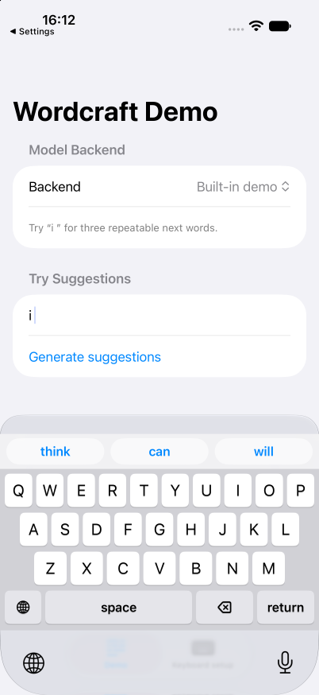

# Wordcraft

Wordcraft is a small iOS keyboard that suggests the next word after a space or punctuation. The companion app lets you compare repeatable, built-in suggestions with answers from an on-device language model.



## Run the demo

1. Clone the repository and open `Wordcraft.xcodeproj` in Xcode. Choose the **Wordcraft** scheme and an iPhone simulator running iOS 17 or later. The standard project uses only Apple frameworks.
2. Press **Run**. The **Demo** tab opens with **Built-in demo** selected on first launch and the sample text `i `.
3. Tap **Generate suggestions**. You should see **think**, **can**, and **will**, followed by the source and latency. Try `thank ` for **you**, **again**, and **everyone**.

The host demo works before you enable the keyboard. For model-generated words, select **Apple Foundation Models** and generate again. This requires an iOS 26 or newer SDK and an available Apple Intelligence model at runtime. When a model is unavailable or yields no usable words, the result reads **Source: Built-in fallback**.

## Try the keyboard

1. In Settings, open **General → Keyboard → Keyboards → Add New Keyboard**, then choose **Wordcraft** under **Third-Party Keyboards**.
2. Return to the demo or open a normal text field in another app. Hold the system globe key and choose **Wordcraft Keyboard**. In Simulator, use **I/O → Keyboard → Toggle Software Keyboard** if the keyboard is hidden.
3. With **Built-in demo** selected in the host app, type `i` followed by a space. Tap **think** in the suggestion bar. The field now ends in `i think `, ready for the next word.

The keyboard reads up to 160 characters before the cursor and processes them on the device. It runs with Full Access off. Secure fields use the system keyboard, and individual apps can disable third-party keyboards. [Apple’s guide to custom keyboard access](https://developer.apple.com/documentation/uikit/configuring-open-access-for-a-custom-keyboard)

### Signing on a physical device

Set the project-level **WORDCRAFT_BUNDLE_ID** build setting to an identifier your team owns, for example `com.example.wordcraft`. Select the same development team for the app and keyboard targets. Enable the App Groups capability for both identifiers and provision `group.<your bundle ID>`. The extension identifier, entitlements, and shared settings derive from the one build setting.

## Optional Gemma experiment

Open `WordcraftMLX.xcodeproj` to build the same app with the pinned MLX and Hugging Face packages. Use the **Wordcraft** scheme, Xcode with the Metal Toolchain installed, and a physical device with sufficient memory. Allow Xcode to resolve the packages and review its prompt to enable the `MLXHuggingFaceMacros` package macro.

In **Demo**, choose **MLX** and tap **Download / Load Model**. Empty fields select `mlx-community/gemma-4-e2b-it-4bit`. You can also enter a compatible repository ID or a local folder readable by the app. The host downloads model files into the shared App Group. The keyboard uses local files only. A custom folder must also be readable by the extension to work there. Keyboard extensions have a smaller memory budget than the host, and iOS may terminate the extension during model loading. Start with the built-in demo for a live presentation.

Model weights are distributed separately by their publishers. Consult the model card before downloading or redistributing weights. [Default Gemma model card](https://huggingface.co/mlx-community/gemma-4-e2b-it-4bit)

## Explore and test

| Directory | What to look at |
| --- | --- |
| [Wordcraft/App](Wordcraft/App) | Backend selection, demo field, and keyboard setup |
| [WordcraftKeyboard](WordcraftKeyboard) | Keyboard layout, text insertion, and cancellation as the cursor moves |
| [WordcraftShared](WordcraftShared) | Context length, candidate parsing, fallback, and model adapters |
| [WordcraftUITests](WordcraftUITests) | A UI smoke test for the built-in demo |

Run **Product → Test** in the standard project on an iPhone simulator. Follow the [manual test plan](ManualTestPlan.md) for keyboard switching, insertion, and model checks.

Both Xcode projects are checked in. After changing the project configuration, regenerate them with [XcodeGen](https://github.com/yonaskolb/XcodeGen).

```sh
xcodegen generate
xcodegen generate --spec project-mlx.yml
```

## License

Wordcraft’s code is available under the [MIT License](LICENSE). Third-party packages and separately downloaded models retain their own licenses.
